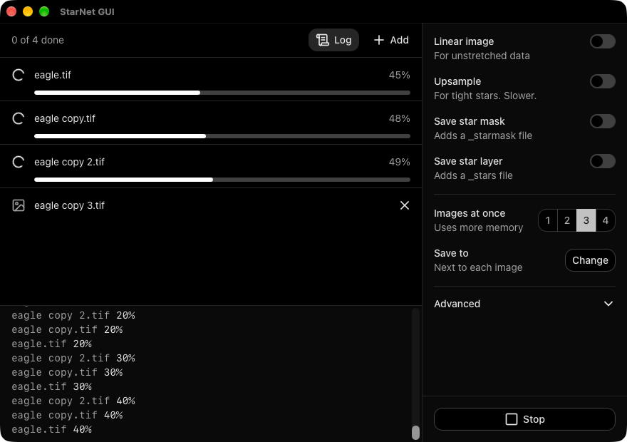
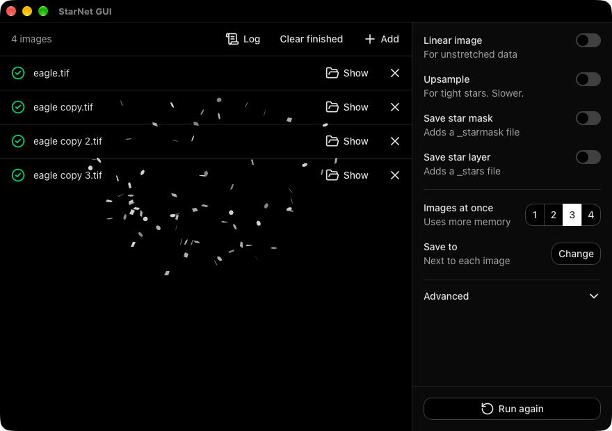

<p align="center">
  
</p>

<h1 align="center">StarNet GUI</h1>

A desktop interface for the [StarNet2](https://starnetastro.com/cli-tools/starnet/) star removal command-line tool, on macOS, Windows and Linux.

<p align="center">
  <a href="https://github.com/Ripwords/starnetGUI/releases/download/v2.0.0/starnetGUI_2.0.0_aarch64.dmg"></a>
  <a href="https://github.com/Ripwords/starnetGUI/releases/download/v2.0.0/starnetGUI_2.0.0_x64.dmg"></a>
  <a href="https://github.com/Ripwords/starnetGUI/releases/download/v2.0.0/starnetGUI_2.0.0_x64-setup.exe"></a>
  <a href="https://github.com/Ripwords/starnetGUI/releases/download/v2.0.0/starnetGUI_2.0.0_amd64.AppImage"></a>
</p>

<p align="center">
  
  
</p>

## Features

- Removes stars from one image or a batch, with drag and drop.
- Reads TIFF, PNG and FITS, including `.fits.gz`.
- Optionally saves a star mask and a star layer next to the starless image.
- Handles linear data, with adjustable stretch, and 2x upsampling.
- Processes up to four images at once, and shows a live log while it runs.
- Shows StarNet2 warnings, such as clipped data or a CPU fallback, on the finished image.
- Finds StarNet2 automatically after a normal install.
- Updates itself when a new version is released.

## Getting started

1. Install the current StarNet2 command-line tool from the [StarNet download page](https://starnetastro.com/cli-tools/starnet/). Choose the installer for your system. This GUI does not include StarNet2.
2. Install StarNet GUI using a button above.
3. Open StarNet GUI, drop your images in, and select **Remove stars**.

If you used the StarNet2 ZIP instead of the installer, StarNet GUI asks you to choose the extracted folder. Keep all the files in that folder together.

**Images at once** sets how many images run together. The default is 2. Each extra image uses more memory, and your graphics card's memory on Windows and Linux, so lower it if images fail on a batch. Select **Log** while a batch runs to see StarNet2's output as it arrives.

Highlight protection, stride, the linear stretch settings and the StarNet2 location are under **Advanced**.

The older `starnet++` tools are not supported. Install the current StarNet2 tool instead.

## Output files

Each result is saved in the same folder as its image, or in the folder you set under **Save to**. Existing files are never overwritten: a number is added to the name instead.

| Option          | File                                |
| --------------- | ----------------------------------- |
| Always          | `name_starless.tif`                 |
| Save star mask  | `name_starmask.tif`                 |
| Save star layer | `name_stars.tif`                    |

Output keeps the input format. A `.fits.gz` input is saved as `.fits`.

Images must be at least 512 x 512 pixels, or 256 x 256 with **Upsample** on.

## First launch warnings

The app is not code-signed with a paid developer identity, so each system shows a warning the first time.

<details>
<summary><strong>macOS</strong>: "starnetGUI is damaged and can't be opened"</summary>

The app is signed ad-hoc but not notarized, so Gatekeeper quarantines it on download. Drag it to **Applications**, then run:

```bash
xattr -cr /Applications/starnetGUI.app
```

</details>

<details>
<summary><strong>Windows</strong>: "Windows protected your PC"</summary>

Select **More info**, then **Run anyway**.

</details>

## Upgrading from version 1

Version 1 cannot update itself to version 2. Download version 2 using a button above and install it once. Later versions update automatically.

## Development

```bash
bun install
bun run dev
```

Run `bun run release 2.0.1` to release. The script updates the version everywhere, points the download buttons above at the new version, then commits and pushes a tag. The Release workflow builds, signs and publishes the installers and the update manifest.

Publishing needs the `TAURI_SIGNING_PRIVATE_KEY` repository secret. `TAURI_SIGNING_PRIVATE_KEY_PASSWORD` is only needed if the key has a password. A tag with a hyphen, such as `v2.1.0-rc.1`, publishes a prerelease, which the updater ignores.
